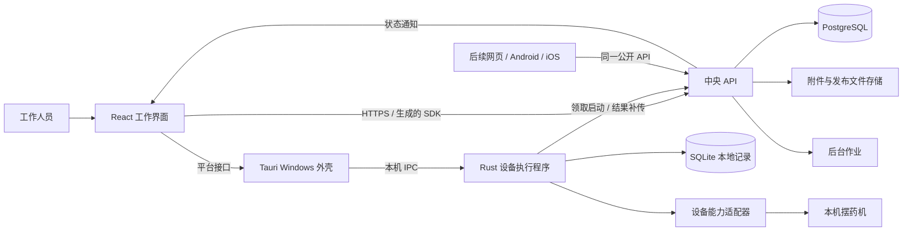

# Pillxai Dispenser 系统架构

架构日期：2026 年 10 月 4 日。本文是新系统的技术起点，依据已确认的业务需求独立设计。本轮没有读取 V0、V1 或其他旧代码。技术资料采用本文链接的官方来源；选型是工程判断，不能解释为每一种技术都由用户逐项指定，方案针对当前目标选择，并通过实际运行持续改进。

## 1. 从必须完成的工作推导结构

系统必须同时完成三件事：让工作人员管理住民用药并操作机器；让同院多台电脑协调任务、共享资料；让已经开始的摆药在断网后继续并留下实际记录。

因此采用三个清晰的运行边界：

| 边界 | 负责完成的工作 | 掌握的状态 |
| --- | --- | --- |
| 独立前端 | 展示、输入、识别入口、人员操作和结果查询 | 页面状态、表单、查询缓存 |
| 中央后端 | 机构权限、处方、计划计算、任务归属、中央记录、发布版本 | 机构业务事实和任务归属 |
| 本地设备执行程序 | 当前机器的动作、进度、暂停、现场处理、本地保存与补传 | 本机真实执行状态及待同步事实 |

前后端通过公开契约通信，可以分别运行、构建、测试和发布。放在同一个仓库是为了协作，不形成前端对后端代码或数据库的依赖。

中央后端以模块化单体交付，本地设备程序是独立进程。模块边界按业务责任划分，进程边界按网络、设备及生命周期划分。Agent 的开发任务可以跨多个模块完成一个用户目标；任务拆分与部署拆分分别决定。



## 2. 当前技术基线及理由

版本状态核查截止 2026-10-04。实施时锁定版本与工具链，使用已有工具或项目内工具完成兼容性构建。用户已授权项目内安装；系统环境、全局 PATH、注册表、驱动和服务变更仍须先获批准。后续版本变化通过明确的依赖更新完成，不在正常构建中自动追随 latest。下表是完整系统的设计基线，0.1.2 实际库与能力以代码锁文件和 [交付说明](10-windows-first-edition.md) 为准。

| 部分 | 当前选择 | 为什么适合本项目 |
| --- | --- | --- |
| 前端 | React 19.3、TypeScript 7、Vite 8.1 | 独立交互应用；组件、状态和平台入口可组合；构建工具快速反馈 |
| 页面组织 | React Router、TanStack Query、Tailwind CSS 与可访问组件基础 | 页面导航、服务数据与界面样式各有明确归属；具体组件库在首个界面切片中锁定 |
| Windows 外壳 | Tauri 2、系统 WebView、NSIS 安装包 | 复用 Web 界面，通过窄接口调用本机能力；支持安装与更新 |
| 中央服务 | Node.js 24 LTS、TypeScript 7、Fastify 5 | 显式组合路由、业务模块和依赖；与前端保持独立发布 |
| API / 消息定义 | TypeSpec，生成 OpenAPI 3.1 与 JSON Schema | 跨语言边界有可生成、可校验的输入输出，减少重复声明 |
| 中央存储 | PostgreSQL 18、Kysely、显式版本迁移 | 查询、事务、约束和历史可直接表达，数据库含义清楚 |
| 本机执行 | Rust stable、Tokio、类型化状态与消息 | 独立于页面和网络请求运行；设备会话顺序明确 |
| 本机存储 | SQLite 3，WAL 模式 | 无需另装本地数据库服务，记录与补传队列可在一个事务内保存 |
| 工程工具 | pnpm workspace、Cargo workspace、Turborepo | 同仓多应用，按依赖图构建与缓存；Rust 命令纳入任务入口 |
| 验证 | Vitest、Playwright、Rust 测试、真实 PostgreSQL 与设备模拟器 | 业务计算、用户操作、设备事件和跨边界流程分别有反馈 |
| 诊断 | 结构化日志、OpenTelemetry 追踪、少量运行指标 | 从任务标识追到中央请求、本机执行与同步结果 |
| 交付 | 独立 Web 静态产物、API 容器、Windows 安装与更新产物 | 可以分别发布，保持声明过的契约兼容 |

React 19.3、Vite 8.1 和 TypeScript 7 的发布资料可由官方核对；TypeScript 7 用于应用类型检查，需要编译器 API 的工具按官方方案使用隔离的 TypeScript 6 兼容包，并在基础阶段验证生成与静态检查链。Node.js 24 当前为 LTS，26 尚未进入其计划中的 LTS 阶段。本次选择 PostgreSQL 18，官方发布资料列出 PostgreSQL 19 仍处于 Beta。这里采用截至核查日可确认的技术基线。[React 版本](https://react.dev/versions)、[Vite 8.1](https://vite.dev/blog/announcing-vite8-1)、[TypeScript 7](https://devblogs.microsoft.com/typescript/announcing-typescript-7-0/)、[Node.js 发布计划](https://github.com/nodejs/Release)、[PostgreSQL 发布资料](https://www.postgresql.org/docs/release/)。

Tauri 提供 Rust 与 WebView 的消息桥接及移动端扩展基础；Fastify 提供插件封装；TypeSpec 可以生成 OpenAPI 和 JSON Schema。这些能力支撑本文的边界选择，整套架构是针对 Pillxai Dispenser 的设计判断。[Tauri 架构](https://v2.tauri.app/concept/architecture/)、[Fastify 封装](https://fastify.dev/docs/latest/Reference/Encapsulation/)、[TypeSpec OpenAPI](https://typespec.io/docs/emitters/openapi3/reference/)、[TypeSpec JSON Schema](https://typespec.io/docs/emitters/json-schema/reference/emitter/)。

新技术的采用依据是对开发速度、交互体验、设备执行或长期维护的实际收益。模型能力增长后，可以调整实现、工具和模块划分；公开业务语义及历史数据解释保持连续。

## 3. 前端结构

前端按工作人员的工作组织功能：工作台、住民、用药、计划、执行、记录、设置。页面调用生成的中央 SDK 和明确的本机平台接口。

- 服务资料与查询缓存由 TanStack Query 管理；失效和刷新围绕成功的业务操作进行。
- 表单输入、当前页面和选择项属于界面状态。
- 当前机器的执行状态来自本机程序的状态快照与事件订阅。界面重载后重新读取快照，不能依靠前端 store 恢复真实执行。
- 计划数量与日期由中央计划计算返回。前端可以展示和解释，不能另外计算一套可执行矩阵。
- 执行中的设备操作经本机接口完成，按钮启用条件采用本机允许动作；权限仍由相应执行入口核验。
- 平台接口表达能力，如识别输入、文件保存、执行命令、更新状态。普通浏览器实例具有管理功能，本机控制能力由实际平台提供。

Windows 和网页入口共享工作界面包。移动端阶段可以复用 SDK、组件和功能包，也可以调整页面组合与触控交互；代码复用程度由实际体验决定。Tauri 的移动支持提供一个候选外壳，设备连接能力须在相应平台阶段确定。

## 4. 中央后端的模块与依赖

| 模块 | 自己负责的数据和行为 | 公开协作入口 |
| --- | --- | --- |
| identity | 机构、人员、权限、当前机构上下文、登录会话 | 已校验的人员与机构上下文 |
| residents | 住民、在院状态、识别标签关系 | 查询住民、解析识别归属 |
| medication | 药品、处方药物条目、用药版本与状态 | 指定日期的有效用药、版本检查 |
| planning | 覆盖规则、共同周期、分盘、剂量转颗粒、计划预览 | 生成带版本及依据的计划 |
| dispensing | 任务、领取、启动归属、结果接收与确认覆盖 | 领取/启动/同步/结束任务 |
| calibration | 每个处方药物条目的参数版本与适用范围 | 读取参数、保存自身新版本 |
| records | 历史查询、筛选、采样导出、标签 PDF 与相关作业 | 查询或创建导出作业 |
| delivery | 发布清单、兼容版本查询与安装结果 | 最新兼容发布、发布记录 |

依赖方向：planning 读取 medication、覆盖查询及设置；dispensing 使用 planning 的结果并拥有任务归属；calibration 使用用药条目标识和执行来源；records 读取已经保存的事实。identity 提供机构和权限上下文。组合入口组装依赖，模块通过公开入口调用，不能导入另一模块的内部实现。

业务逻辑使用普通 TypeScript 函数和对象。HTTP 处理器负责请求与响应转换，存储适配负责 SQL，业务计算使用明确的输入输出。只有逻辑规模和替换需求值得时才继续分层，避免每个简单操作产生大量转发类。

计划规则在纯计算包中实现，并通过固定样例验证。中央后端是生产计划的唯一执行入口；该包可供测试及未来其他后端适配使用。

跨模块需要同时提交的事实使用一个 PostgreSQL 事务，例如接收批次结果、确认覆盖、登记同步去重。可以在组合用例中调用参与模块的事务入口，避免网络式内部 RPC 或隐藏的连锁订阅。

## 5. 本地设备执行程序

程序以一个设备会话为中心：同一终端的一台机器由一个执行 actor 串行处理操作和反馈。连接读取、本地写入、上传及界面订阅各自异步运行，设备动作顺序由会话状态决定。

程序拥有以下责任：

1. 接收中央确认的完整任务及参数快照，持久保存。
2. 在允许阶段执行开始本药、暂停、恢复、现场处理、换盘及取盒操作。
3. 通过设备适配器把语义操作转换为机器协议。
4. 保存命令意图、已知反馈、采样和人工结果，产生稳定事件身份。
5. 在线补传事实，离线继续已经开始的任务。
6. 向界面提供当前快照、允许操作、待同步数量与增量事件。

执行核心使用类型化的状态、事件和转移函数；副作用由运行层完成。状态转换可在没有串口、界面和网络的测试中验证。设备状态、任务结果和同步状态分别表达。

设备适配器只实现已经确认的能力。新系统内的任务编号可以关联接收事件，但不能因此假定机器报文包含这个编号。未知完成、迟到反馈与断开后的现场状态保留为未知，按业务流程处理。

本轮不从历史代码取得协议。实施实际硬件适配前，把缺少的连接方式、命令时序和反馈语义整理成具体问题向用户确认；可由用户提供现行协议、说明或实机测试结果。文档中此前蒸馏的设备信息是确认问题的线索，不能代替此次用户要求的沟通。

### 进程与本机通信

Windows 外壳把本地程序作为随安装包分发的外部二进制启动。Tauri 提供 sidecar 打包机制；本项目自行实现会话与进程生命周期。[Tauri 外部二进制](https://v2.tauri.app/develop/sidecar/)。

首版采用外壳拥有的子进程，通过标准输入与标准输出传递换行分隔的 JSON 请求和响应；每个请求带标识，外壳顺序处理并核对响应。WebView 通过 Tauri 命令读取状态和提交语义操作。本机设备程序不监听 HTTP 端口，独占该电脑的串口与执行数据；开发时的浏览器桥接仅用于验证。

桌面应用通过单实例机制持有一个本机执行程序。WebView 重载不结束本地任务，关闭窗口直接退出，不驻留托盘；退出前向正在执行的机器请求暂停并保存进度，随后关闭本应用拥有的设备程序和试用服务。本地进程重启时保留任务和未上传事件，执行中的任务进入现场核对，不宣称断电后机器自动恢复。契约版本握手和跨语言类型生成属于后续完善项；首版实际范围见 [Windows 首版交付](10-windows-first-edition.md)。

中央后端管理资料、计划及归属，本地程序直接调用中央执行接口领取启动许可和同步结果。前端发起用户意图，关键启动检查由本地程序与中央协作完成，防止页面与执行程序各自持有一套启动判断。

## 6. 契约与事件

TypeSpec 是公开数据结构和 HTTP 接口的权威源，按业务命名空间拆分。生成物包括 OpenAPI 3.1、JSON Schema、TypeScript SDK，以及经过跨语言样例验证的 Rust 传输类型。Rust 类型生成器在基础验证阶段选定，必须实际验证枚举、可空值、时间和整数转换。

生成文件标注来源，由生成命令统一更新。页面模型、后端内部对象和数据库结构可以各自组织，只在边界映射到契约。公开 DTO 不携带数据库访问或业务副作用。

### 三类通信

| 通信 | 请求 | 返回与订阅 |
| --- | --- | --- |
| 前端 → 中央 | 资料维护、预览、查询、导出、版本检查 | 生成的 HTTP SDK；同院状态变化通过 SSE 通知并刷新查询 |
| 本机 → 中央 | 领取、启动许可、事件批量同步、结束状态 | HTTP；明确的已接收身份及业务冲突 |
| 前端 → 本机 | 开始药物、暂停、恢复、人工处理、换盘、取盒 | 类型化 IPC；快照与带序号的本机事件 |

设备中断恢复入口：`continueInterrupted` 接收统一契约 `ContinueInterruptedInput`（任务、批次、人工确认原进度保留），仅恢复原批次。`prepareDiscard` / `finishDiscard` 接收 `DiscardExecutionInput`，前者持久化 `discarding` 阶段并关闭串口，后者在中央删除成功后事务删除本机任务数据。中央 `POST /tasks/{id}/discard` 校验机构和原终端、显式确认，只删除未结束任务，任务已不存在时允许幂等重试。删除后迟到同步不得重建任务。重启保留 `discarding`，任何设备控制均不可用，直到中央、本机删除完成。业务和留存例外见 02 R12、03。

SSE 是查询刷新通知。通知连接重建后重新拉取资料；接收失败不会决定任务是否真实完成。本机订阅带本地递增序号，发现序号缺口重新读取快照。接收机器原始数据和节流界面显示分别处理，原始采样完整留存。

公共记录至少包含：契约版本、事件身份、机构、终端、设备、任务/批次关联、来源、时间、内容。关联不明时明确保存关联质量。时间戳使用 UTC 表达时刻，业务日期另带机构时区；原片剂量用精确十进制或有明确分母的表达，颗粒数用受能力约束的整数。跨语言的大整数在传输上采用字符串策略。

接口约定包括资源版本、重复提交身份和可理解的错误码。重复的业务提交返回既有结果；相同身份但不同内容返回明确冲突。机器动作无法靠 HTTP 幂等性获得物理上的恰好执行一次，命令结果不明必须按执行状态处理。

## 7. 数据与机构隔离

PostgreSQL 保存中央业务事实。业务记录带稳定身份和机构归属；同机构关联使用包含机构身份的约束，防止错误关联到别院。

数据分成三个用途：当前可操作资料、不可改写的历史版本/结果、由历史计算出的查询与覆盖视图。视图可以重建；处方和执行事实不能被视图覆盖。需要保存实际事件，但无需把全部业务实现成事件溯源框架。

每个处方药物条目拥有稳定身份；原条目普通修改生成版本，保留其自身适用的参数；新建、复制形成新条目标识并独立学习。多药处方可以保存一个分组身份，日常仍可逐药维护。该分组不能导致学习结果合并，也无需引入额外的处方审批流程。

中央查询与修改从已校验的机构上下文取得范围。数据库以行级策略落实机构访问，连接中的机构设置限于当前事务，应用连接不使用可绕过策略的角色。平台管理员选择机构后以该院上下文处理业务；跨院管理入口单独表达。附件下载、导出和通知沿用同一机构范围。[PostgreSQL 行级策略](https://www.postgresql.org/docs/18/ddl-rowsecurity.html)。

SQL 迁移是存储结构的权威变更来源，数据库类型由迁移后的测试数据库生成；Kysely 提供类型化 SQL 查询。API DTO 由契约生成，数据库类型由存储生成，二者通过显式映射衔接。[Kysely](https://kysely.dev/)。

### 本地持久化与补传

本地 SQLite 保存完整任务快照、执行事件、采样、当前会话快照和待上传队列。执行事实与待传项在同一事务提交。关键阶段立即提交；高频采样按有界小批量保存，批次结束前刷出。最大批量间隔在 N01 负载测试中确定并报告，未确认的尾部事件保持未知。

采用 WAL 与 `synchronous=FULL` 作为初始配置，所有 SQLite 写入由专门存储队列完成。设备读取和界面订阅不会同步等待每一条采样的文件刷盘。持久化队列积压或写入失败必须呈现，不能显示记录已保存。[SQLite WAL](https://www.sqlite.org/wal.html)、[SQLite synchronous](https://sqlite.org/pragma.html#pragma_synchronous)。

同步采用稳定事件身份与逐项确认。服务器按 `(机构, 终端, 事件身份)` 去重，在同一事务保存事实与接收结果；客户端只有收到确认后才标记已同步。参数采用基础版本检查，旧结果仍保留历史但不会覆盖新的当前值。

中央采样采用按接收月份分区的原始记录表，保留实际发生时间。索引围绕机构、任务/批次和时间查询。样本量增长时可移到带索引清单的压缩文件存储，导出仍可访问完整原始数据；每次归档验证数量和完整性，全部数据长期保留。

附件、发布包和大导出通过一个文件存储接口访问。首版使用部署数据卷上的文件存储，元数据在 PostgreSQL；需要多实例共享时替换为对象存储。数据库、已保存文件和本机数据分别有明确目录与备份办法。

## 8. 一次摆药的数据路径

1. 前端提交预览请求；中央读取有效用药、设置与覆盖，返回计划和来源版本。
2. 用户识别药盒并发起开始。本地程序请求中央领取，中央在事务内核对版本、机器和任务占用。
3. 本地程序保存完整快照，向中央确认进入启动阶段；本地保存启动意图后再执行第一条设备命令。任何交界结果不明时核对原任务，不能自动重领。
4. 机器反馈由本地程序记录并驱动状态；前端订阅进度。网络中断后当前任务继续。
5. 本地程序补传事件，中央保存事实、确认覆盖并更新查询；其他终端收到通知后刷新。
6. 所有药处理结束后完成取盒与本机就绪，释放执行占用；查询页面可分别看到计划、机器报告、人工处理与同步状态。

这一流程提供软件事实的可重复接收与明确归属。物理动作的能力和恢复仍以实际设备及用户确认的操作为准。

## 9. 仓库与依赖方向

以下目录是实施目标，目前不表示已经创建应用或实现相应命令。

```text
Pillxai Dispenser/
├─ AGENTS.md                    # 项目入口与开发原则
├─ docs/                        # 业务、架构、交付依据
├─ assets/branding/             # 原始品牌素材
├─ apps/
│  ├─ web/                     # 浏览器入口、部署产物
│  ├─ desktop/                 # Windows 入口、Tauri 桥接与打包
│  └─ api/                     # 中央服务组合入口
│     └─ src/modules/          # 业务模块，各自公开入口
├─ packages/
│  ├─ contracts/               # TypeSpec 源与生成配置
│  ├─ sdk/                     # 生成的中央客户端与传输模型
│  ├─ workbench/               # 共享页面、功能与界面组件
│  ├─ platform/                # 前端所用平台接口与实现
│  ├─ dispensing-policy/      # 纯计划计算
│  └─ testkit/                 # 固定样例、模拟服务与测试辅助
├─ native/
│  ├─ Cargo.toml               # Rust workspace
│  └─ crates/
│     ├─ machine-runtime/      # 状态、会话、同步、进程入口
│     ├─ device-adapter/       # 语义能力接口与实际设备适配
│     └─ local-store/          # SQLite 与本地迁移
├─ database/
│  ├─ migrations/              # 中央 SQL 迁移
│  └─ generated/               # 由迁移后的数据库生成的类型
├─ tests/
│  ├─ fixtures/                # 跨语言输入输出、设备轨迹
│  ├─ contracts/               # 边界验证
│  └─ journeys/                # 工作人员完整工作流程
├─ tooling/                    # 生成、检查与任务命令
├─ deploy/                     # 服务、Web、存储、备份与发布
└─ legacy/                     # 归档，开发任务不读取
```

依赖约束由工作区与静态检查落实：

- workbench 依赖 sdk、platform 的接口和自身 UI；不能依赖 api 或 database。
- api 的 HTTP 适配使用契约，业务模块通过自己的公开入口协作。
- dispensing-policy 不依赖 HTTP、数据库、React 或本机设备。
- machine-runtime 使用设备语义与本地存储接口；设备编码和传输在适配器内。
- shared / utils 不承担跨模块业务状态。新抽象需有实际复用或替换需求。

目录允许按实现规模演进。结构调整要能解释依赖、迁移与验证结果，不能仅为了符合这张目录树增加空包。

## 10. 部署、更新与运行

首版中央部署为一个 API 实例、一个后台作业实例、PostgreSQL 和持久文件存储；后台作业复用同一后端代码和业务模块，以独立进程运行导出、PDF、备份等工作。PostgreSQL 作业表保存状态和领取，短事务领取后在事务外执行，作业拥有完成标记与失败重试语义。

Web 前端作为独立静态产物部署，Windows 包内包含界面、本机执行程序和平台适配。开发及验证在独立构建环境使用可重复的容器配置；默认不在用户电脑安装容器工具或改造开发环境；确有必要时先申请批准。生产部署由配置决定主机与数据卷，不要求先搭建容器集群。

下载图标查询兼容发布，完成签名验证后等待任务结束、取盒及本机空闲再安装。Windows 安装与更新使用 Tauri updater 支持的机制；初始采用用户范围 NSIS 安装及 passive 更新模式，实际安装权限在干净 Windows 电脑上验证。[Tauri updater](https://v2.tauri.app/plugin/updater/)。

发布兼容性分别声明中央 API、IPC、本地数据结构、设备配置和最低支持客户端。数据迁移先允许新旧代码兼容，再在相应版本退出后收敛。安装程序、发布包和数据恢复各有可验证结果。

诊断用任务/批次身份关联日志，性能测试按 07。用户界面展示可执行的处理步骤，原始诊断内容在支持入口导出。备份与恢复范围由 N05 定义，实施后保留恢复演练结果。

## 11. 允许演进的方向

| 观测到的需求 | 可以采用的演进 | 保持连续的含义 |
| --- | --- | --- |
| 管理用户增加、API 实例增加 | 增加服务实例及跨实例通知实现 | 机构上下文、任务原子归属 |
| 原始采样长期增长 | 扩展分区、压缩归档和对象存储 | 原始值、来源、完整导出 |
| 导出任务持续积压 | 扩展 worker 并行与作业调度 | 同一作业身份和结果 |
| 新机型或新连接方式 | 增加设备能力适配 | 药物计划、执行事件和未知事实 |
| 移动端需求确定 | 新平台入口与适配 | 用药安排、权限、记录语义 |
| 更强 Agent 能完成更大任务 | 扩大任务范围、减少中间交接、重整模块 | 用户目标、公开契约、可验证结果 |

新增服务、缓存、队列、工作流引擎或数据库以测得的需求为依据。公开契约与可运行样例使替换可局部完成；架构的价值在于改变实现时仍能完成原有工作。

## 12. 架构完成的判断

实现通过以下观察判断架构有效：前端可以使用模拟服务独立开发；API 可以在没有桌面外壳时完成业务验证；本机执行可以在没有界面时完成模拟设备轨迹；网络断开后当前任务继续；重新打开界面取得真实进度；不同机构和机器事实各自归属；更新与历史查询可由工作人员完成。

并行开发、任务交接、命令入口及阶段顺序见 [09 Agent 协作与实施路线](09-agent-development.md)。实际结果优先于目录形式、框架数量或宣传性名称。
