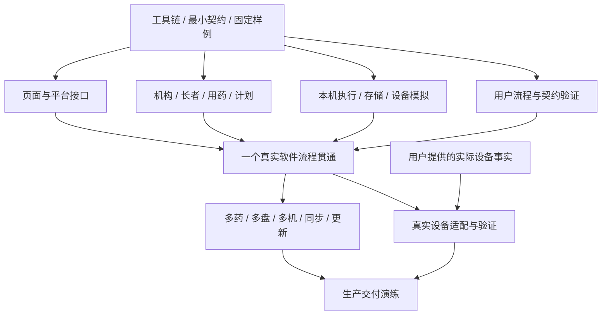

# Pillxai Dispenser Agent 协作与实施路线

日期：2026 年 10 月 18 日。当前采用 Flutter + Python/FastAPI 重写，首发 Android 平板直连 HC-06。已建立 `apps/client` Flutter 客户端交互预览，采用用户确认的极简风格作为唯一界面；移除方案切换栏和其他方案，继续完善处方管理。处方管理、摆药与设置使用内存演示数据。FastAPI、HC-06、后台生命周期和生产数据持久化尚未实现。运行入口、实际验证结果和当前限制见[客户端说明](../apps/client/README.md)；预览不代表生产业务或真实设备能力已完成。本文件规定如何把业务文档与 [08 架构](08-system-architecture.md)转成可运行的新产品。路线面向能跨模块完成任务的智能 Agent，不固定供应商、模型名称、Agent 数量或单个任务大小。

## 1. 以完成工作衡量开发

开发的目标是让工作人员在生产环境完成真实摆药工作，并能维护资料、查询结果和更新软件。不同 Agent 可以采取不同实现，强模型可以提出并验证更好的方案。

评估一项实现时依次看：

1. 用户确认的业务目标是否完成，设备事实是否真实。
2. 工作人员能否顺利操作，常见中断后能否继续处理。
3. 数据归属、数量、版本和历史能否解释。
4. 代码责任与依赖是否清楚，替换和扩展是否局部可做。
5. 构建、验证、安装与发布是否可重复。

代码必须可读且精简：名称说明业务含义，模块责任集中，依赖直接可查；只引入有实际复用或替换需求的抽象，不为减少行数压缩表达。UI 保留用户已认可的低信息密度与三个入口侧边栏，当前按 06 的颜色、品牌、组件与平板比例要求实现可操作的 Flutter 界面。当前以用户确认的极简风格作为唯一界面，移除底部方案切换栏与其他方案。后续沿用这套视觉语言完善处方管理、摆药与设置，不继续保留多方案比较入口。用户提供的原型和参考图继续保留。

默认按钮、目录、库和操作组合是起点。Agent 可以调整，说明对用户结果的改善，直接修改相关文档和验证。对真实业务含义的改变需要用户输入；普通技术选择由 Agent 自主完成。

## 2. 给 Agent 一个明确入口

根目录 AGENTS.md 提供短入口，docs/README.md 提供文档地图。业务权威内容在 00–07，架构和实施路线在 08–09。90–91 保存历史来源，日常开发不把它们作为实现输入。

用户要求不修改其电脑的系统环境，已授权项目目录内的工具链、依赖和缓存安装，无需逐项申请。使用现有工具或仓库内显式路径；构建环境变量仅在本次进程中配置并恢复。全局工具、全局 PATH、注册表、驱动、系统配置和服务变更仍须先获批准。

每个模块在实现时维护简短 README：责任、公开入口、依赖、拥有的数据、运行方式、相关案例和当前限制。复杂模块可有局部 AGENTS.md，仅补充该模块实际需要的开发约定。

背景材料按任务提供：长者功能使用长者与识别规则，执行功能使用设备能力与状态规则。避免每项小任务都加载整个仓库，也允许能处理大范围任务的模型读完整上下文。

用户最新要求：不读取、搜索、复制或参考任何旧代码；不以 legacy 中的结构、库、类、表和页面作为设计起点。需要了解以前机器的实际使用情况时，向用户提出具体问题。硬件工作可先使用语义模拟器，真实适配等待所需事实明确。

## 3. 并行的基础是公开边界

并行开发以可运行契约和独立验证入口为支点：

- API、事件及 IPC 结构在 contracts 的命名空间中定义。
- 页面依赖生成的 SDK、平台接口和可运行模拟。
- 后端业务模块有公开入口及真实存储验证。
- 设备执行依赖语义设备接口和可重放反馈轨迹。
- 跨边界的固定样例放在 tests/fixtures，包含业务输入、期望结果及来源。

Agent 可以在对方功能尚未完成时开发自己的完整切片。早期就把模拟替换成真实协作验证；模拟接口与实际接口使用相同契约。



图中节点代表依赖，并非固定团队人数。一位更强 Agent 可以完成多个节点，多位 Agent 也可以在一个大节点中按清晰责任分工。

## 4. 推荐的并行工作线

| 工作线 | 独立交付物 | 主要协作边界 |
| --- | --- | --- |
| 契约与工程 | 单一 API 契约、Dart SDK 生成、工作区、统一命令和依赖检查 | FastAPI/OpenAPI 生成验证、契约版本与生成物 |
| 业务后端 | 机构、人员、长者、用药、计划和任务归属 | API、公开模块入口、SQL 迁移 |
| 产品界面 | 工作台、用药维护、计划、执行及查询体验 | API SDK、平台接口、本机快照 |
| 本机执行 | 状态转换、本地存储、Android 后台执行、补传与模拟设备 | 平台接口、执行接口、设备语义 |
| 数据与交付 | 查询、采样、PDF、安装、发布与更新 | 已保存事实、作业与发布契约 |
| 集成验证 | 跨语言样例、完整工作流程、多机及持续运行 | 可运行软件与验收结果 |

协调 Agent 负责当前目标、依赖、接口变更和集成结果，不替所有工作线编写内部代码。实现与验证可由不同 Agent 交叉检查；最终以可复现的运行结果判断完成。

## 5. 任务包

任务使用用户能识别的目标命名，例如“工作人员暂停后继续同一药物”，而不是只写“实现暂停接口”。任务包记录：

```text
目标：工作人员要完成什么
输入：相关规则、契约版本、固定样例、已有模块状态
负责范围：本任务通常修改的模块及协作对象
结果：正常流程、失败或中断时用户能看到什么
验证：运行入口、覆盖的验收案例、所需真实环境
交接：公开入口变化、生成物、迁移、已知未完成项
```

文件范围用于减少同时改写同一处，不禁止必要的跨模块完成工作。需要改变共享契约时先将新的输入输出同步给相关工作线，再合入兼容实现；可以在同一任务内完成连贯变更。

并行任务使用独立分支或工作区。共享锁文件、根工程配置和生成入口由当前负责工程整合的任务统一更新；各模块拥有自己的源文件与迁移片段。迁移使用唯一名称，集成时统一确定执行顺序，避免多人争抢连续编号。

每次集成重新生成契约和数据库类型，运行受影响验证。任务完成报告给出实际结果、验证方法及未解决内容，不以代码量、Agent 数量或阅读了多少文件作为进度。

## 6. 第一阶段：把反馈通道建起来

用户已确认当前极简风格为唯一界面，保留低信息密度和“处方管理”“摆药”“设置”三个入口侧边栏，不设置返回页或全局返回按钮。方案切换栏和其他方案不再保留；当前沿用这套风格完善处方管理，再逐步完成其余模块。交互预览以 06 的导航、颜色与信息层级为准，三个模块共享内存演示数据。运行入口、实际验证结果与限制见[客户端说明](../apps/client/README.md)；用户原型与参考图继续保留。契约、后端、设备通信验证可独立推进。以下基础能力仍须逐项实现和验证，不能由 GUI 预览代替。

- 核查并锁定 Flutter、Dart、Python、FastAPI、存储、设备适配及契约生成器版本。使用已有工具或项目内工具实际构建；项目目录内的安装已获授权，系统范围的变更另行申请。
- 创建前端、API、本机程序的最小独立入口与各自验证入口。
- 选择公开契约权威格式，实现一条最小契约，验证 Dart 客户端与后端类型、校验和时间数量语义实际兼容。
- 用一份固定计划运行本机状态转换、模拟设备反馈、本地写入和结果上传。
- 建立虚构机构与长者数据，一条用户操作可以在日志和记录中关联到同一任务。

Flutter 到本机执行核心的平台接口、FastAPI/OpenAPI 到 Dart 的契约生成链、Android 签名安装包均在本阶段验证；优先用用户现有平板测试直接 HC-06 连接、前台服务、切换应用与锁屏。GUI 预览与测试入口均不能替代真实设备与平台验收。Windows 和 iOS 的构建与连接在后续阶段分别验证，不让其他平台阻塞首发。独立进程、原生插件或语言绑定按实测选择；生成器不能准确表达所需形状时调整工具或契约，不凭方案文字声称兼容。

阶段结果是可运行的反馈回路，后续 Agent 能快速确认自己的改动是否产生预期结果。

## 7. 第二阶段：一个工作人员目标贯通

用虚构资料跑通：登录本院 → 建长者与用药 → 按设置生成计划 → 模拟识别长者 → 开始一种药 → 接收计数和完成 → 取盒 → 查询实际记录。

前端、API、本机程序在这一阶段使用真实通信；只有外部机器用模拟器替代。记录保存、归属和计数使用生产实现。这样可以早发现边界问题，而不会让三套完整但无法接合的应用分别成熟。

页面沿用用户选定的视觉风格，让用户或代表工作人员在平板试用，观察触控与信息可读性。按钮与页面组合根据完成工作的表现调整。

## 8. 第三阶段：并行扩展完整能力

在贯通流程上分别推进：

| 能力 | 可观察的完成结果 |
| --- | --- |
| 机构与账号 | 平台建院、管理员建员工、普通员工只操作本院 |
| 用药与覆盖 | 设置长期沿用，多药共同日期、半片、有限疗程和修改可解释 |
| 执行与现场处理 | 多药、餐食分盘、睡前位置、暂停、换盘强制重新识别、自动取盒检测和人工补齐可完成 |
| 离线与同步 | 当前任务断网可完成，联网补传可查，重复补传无重复动作 |
| 独立参数 | 每条处方药物独立学习，形态变化重新调整，旧回传保留历史 |
| 查询与留存 | 历史、原始采样、附件及更正均可查或导出 |
| 标签与交付 | 新批量 PDF 标签、新 RFID 绑定、开发者手动安装及升级恢复可使用，不导入旧数据或参数经验 |

现有验收案例用来覆盖结果。默认设计改变时，相应案例改为验证新的可见结果，保留用户已确认的核心要求。

## 9. 第四阶段：接入真实机器

设备工作线向用户确认缺少的真实使用和协议事实，形成简短的当前设备能力说明，再实现适配器。

真实验证从第一阶段即开始，不把 HC-06 与 Android 生命周期留到最后。完整验证包括位置对应、开始后投料、累计进度、完成反馈、暂停保留、每次换盘重新识别、稳定取盒自动收回和失败人工确认；分别验证切换应用、锁屏、受控退出和系统强杀。现场观察保存为可解释的测试结果，需要时形成用户允许保留的匿名反馈轨迹供后续回放。

模拟器用于验证软件行为，实机用于确认设备能力。软件内部编号、模拟完成和候选参数公式都不能代替真实机器反馈。

## 10. 第五阶段：生产交付

按 07 的负载验证 4 院、约 800 人、24 台各自工作的机器会话，检查响应、记录、机构归属、长期数据查询和持续运行。

由普通工作人员完成日常演练：多位长者连续摆药、用药修改后的下一次摆药、暂停和换盘、锁屏与切换应用、断网后继续及查询结果。开发者负责现有公网服务器的部署维护演练，验证 Android 首次手动安装、空闲升级、中央备份恢复及本机未上传结果；各院验证同一服务下的数据隔离。

交付说明写清实际通过、未通过和未实测项。生产版完成意味着用户工作可实际完成，不意味着目录、接口或验收文字已经全部写出。

## 11. 统一命令与自动反馈

Flutter 客户端工程已建立于 apps/client；运行命令、工具链、产物位置、实际验证结果与当前限制统一见[客户端说明](../apps/client/README.md)。下表区分客户端已建立的入口与仍需建立或完成的生产验收入口；存在入口不代表该项验收已通过：

| 入口 | 目的 |
| --- | --- |
| Flutter 静态检查和测试 | 已建立客户端入口；在 apps/client 运行 `flutter analyze` 与 `flutter test`，实际范围和结果见客户端说明 |
| Flutter 平台运行 | 客户端预览运行方式见客户端说明；所选终端与平台能力分别验证，浏览器预览不代表 Android 实机验收通过 |
| 中央服务启动与测试 | 待实现：Python/FastAPI 服务提供明确命令及隔离数据库 |
| 契约生成与一致性检查 | 待建立：从 FastAPI 公开模型导出 OpenAPI、生成 Dart SDK 并检查契约漂移 |
| 设备模拟与完整流程 | 当前 GUI 使用内存演示；生产状态、离线保存、补传和异常流程仍待实现与验证 |
| 平台构建与实机验收 | 平台构建状态见客户端说明；HC-06、后台与锁屏、受控退出及强杀恢复待实现与实机验证，后续平台分别验证 |
| 数据与负载验收 | 生产持久化尚未实现；新建数据、恢复演练及 N01–N03 负载验证待完成，不做旧数据迁移兼容 |

不保留已经撤下实现的命令作为有效开发入口。选定额外语言时，将其检查与测试纳入统一验证入口。
代码检查发现越过模块内部、前端依赖后端、生成物被手改或契约漂移时给出明确反馈。验证重点放在业务计算、跨边界数据和真实操作；无需为简单字段转发或目录形式堆积测试。

## 12. 随模型能力增长演进

模型升级首先反映在任务范围和反馈速度上：可以完成更长的业务切片、提出更好的局部设计、直接修改更多相关模块，并借助同一套运行入口验证。

持续保留四种资产：清楚的用户目标、公开契约、可运行样例、实际验证记录。这些资产可被不同模型和工具理解；实现可以替换，任务划分可以重整。

任务清单与文档由实际变化维护。减少已经没有价值的中间交接和固定角色，允许强模型自主完成整条工作线。并行度取决于真实依赖和集成成本，而非预设需要多少 Agent。

Agent 是开发方式。产品的日常摆药依据明确处方、确定计划、设备反馈和人员操作运行；开发模型的名称和服务可用性不成为机器执行的依赖。
